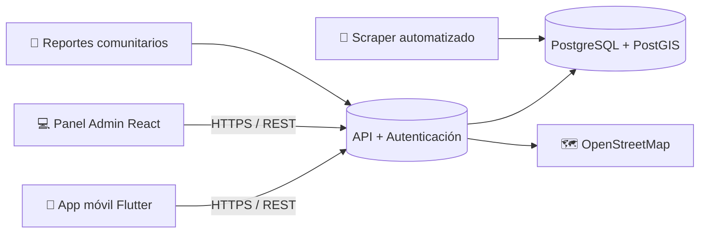
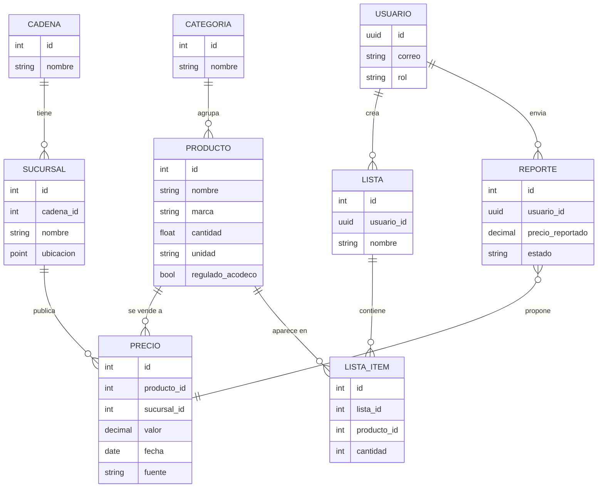
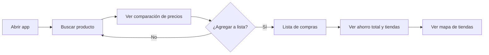
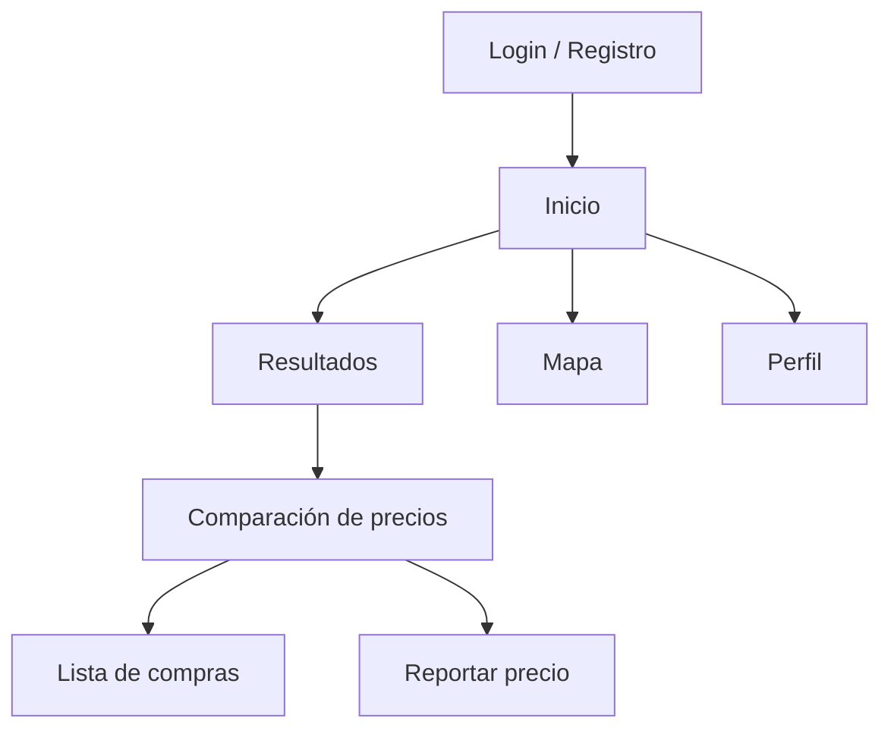

# 🛒 PrecioYa PA

**Comparador de precios de alimentos de la canasta básica en supermercados de la ciudad de Panamá**

> Borrador del proyecto — Curso de Desarrollo de Aplicaciones Móviles
> **Estudiante:** `[ Nombre completo ]` · **Profesor(a):** `[ Nombre del docente ]` · **Fecha:** `[ dd/mm/aaaa ]`
> **Estado:** 📝 Fase de diseño (sin código todavía) · **Versión del documento:** 0.3.0

---

## Índice

1. [Descripción del proyecto](#1-descripción-del-proyecto)
2. [Exposición del problema](#2-exposición-del-problema)
3. [Plataforma](#3-plataforma)
4. [Interfaz de usuario e interfaz de administrador](#4-interfaz-de-usuario-e-interfaz-de-administrador)
5. [Funcionalidad](#5-funcionalidad)
6. [Diseño (wireframes y esquemas)](#6-diseño-wireframes-y-esquemas)
7. [Riesgos y mitigación](#7-riesgos-y-mitigación)
8. [Hoja de ruta](#8-hoja-de-ruta)
9. [Changelog](#9-changelog)

---

## 1. Descripción del proyecto

**PrecioYa PA** es una aplicación móvil (Android primero) con un panel web complementario para administradores. Ayuda a los consumidores de la ciudad de Panamá a **encontrar dónde comprar más barato** los alimentos y productos de primera necesidad entre los principales supermercados (Super 99, Rey, Riba Smith, El Machetazo, PriceSmart, entre otros).

**Objetivo general:** centralizar los precios de la canasta básica y permitir compararlos entre cadenas y sucursales para reducir el gasto del hogar.

**Objetivos específicos:**

- Permitir buscar un producto y ver su precio en distintas tiendas en 2–3 toques.
- Calcular el ahorro estimado de una lista de compras completa.
- Mostrar siempre la **fecha y la fuente** de cada precio para generar confianza.
- Identificar los productos bajo régimen de control de precios de ACODECO.
- Ofrecer a los administradores herramientas para mantener los datos actualizados.

**Público objetivo:** familias panameñas, estudiantes y adultos mayores que buscan optimizar su presupuesto de alimentos.

## 2. Exposición del problema

En la ciudad de Panamá, el precio de un mismo producto puede variar entre supermercados e incluso entre sucursales de la misma cadena, según promociones, ubicación y reabastecimiento. **No existe una herramienta unificada y sencilla** que permita comparar esos precios antes de comprar.

**Causas:**

- Cada cadena publica sus precios solo en su propia app, sitio web o folleto.
- Los precios cambian con frecuencia (ofertas semanales, inflación, promociones puntuales).
- Los hogares de menores ingresos, los que más ganan con comparar, son los que menos tiempo tienen para hacerlo manualmente.

**Consecuencias:** gasto innecesario, poca transparencia del mercado y menor competencia entre cadenas.

**Pregunta central:** ¿cómo puede una aplicación móvil ayudar a los consumidores de la ciudad de Panamá a identificar, de forma rápida y confiable, en qué supermercado encontrarán los alimentos que necesitan al menor precio?

**Justificación:** una solución digital centralizada reduce el tiempo de búsqueda, promueve la transparencia de precios e incentiva la competencia, con impacto directo en la economía del hogar.

## 3. Plataforma

App móvil **multiplataforma** con un solo código base. El MVP se prueba y publica **primero en Android**; iOS queda para una fase posterior. Se complementa con un panel de administración web.

### 3.1 Tecnologías propuestas

| Componente | Tecnología | Justificación |
|---|---|---|
| App móvil | **Flutter (Dart)** | Un código base para Android e iOS, buen rendimiento y ecosistema de mapas. |
| Panel administrador | **React** (web responsive) | Carga y edición de precios desde cualquier navegador. |
| Backend / API | **Supabase** (MVP) → NestJS si el proyecto crece | Autenticación, API REST y base de datos listas, lo que reduce el trabajo inicial. |
| Base de datos | **PostgreSQL + PostGIS** | Consultas por proximidad de sucursales y precios históricos. |
| Búsqueda | Búsqueda de texto completo de PostgreSQL (MVP) → Meilisearch/Typesense en Fase 2 | Suficiente para un catálogo inicial pequeño. |
| Mapas | **OpenStreetMap** (`flutter_map`) | Gratuito; Google Maps queda como opción si se justifica el costo. |
| Notificaciones | Firebase Cloud Messaging | Alertas push (Fase 2). |
| Control de versiones | Git + GitHub | Seguimiento del avance y documentación. |

### 3.2 Requisitos mínimos

- Android 8.0 (Oreo) o superior · iOS 14+ (fase posterior).
- Conexión a internet para sincronizar; modo consulta offline con la última lista descargada.
- Permiso de ubicación **opcional** para sugerir tiendas cercanas.

### 3.3 Arquitectura general



## 4. Interfaz de usuario e interfaz de administrador

### 4.1 Interfaz de usuario (app móvil)

| Pantalla | Contenido |
|---|---|
| **Inicio / Buscador** | Barra de búsqueda, categorías de la canasta básica y ofertas del día. |
| **Resultados** | Lista de productos con el precio más bajo destacado. |
| **Comparación de precios** | Mismo producto en cada tienda, con precio, precio por unidad (PUM), fecha de actualización y etiqueta ACODECO. |
| **Lista de compras** | Productos guardados, total por supermercado y ahorro estimado. |
| **Mapa** | Sucursales cercanas con filtro por cadena. |
| **Perfil** | Cuenta, listas guardadas, historial y preferencias. |

**Principios de diseño:** simplicidad visual, textos grandes y legibles, máximo 2–3 toques de la búsqueda a la comparación, y accesibilidad para adultos mayores.

### 4.2 Interfaz de administrador (panel web)

| Módulo | Contenido |
|---|---|
| **Dashboard** | Productos, sucursales activas, precios desactualizados y reportes pendientes. |
| **Productos** | Alta, edición y categorización. |
| **Sucursales** | Registro de cadenas y sucursales con ubicación. |
| **Precios** | Edición individual y carga masiva por CSV. |
| **Reportes comunitarios** | Aprobar o rechazar precios enviados por usuarios. |
| **Usuarios y roles** | Super admin, admin de cadena y editor de sucursal. |
| **Reportes** | Exportación a CSV/PDF y métricas de uso. |

## 5. Funcionalidad

### 5.1 Usuario (consumidor)

- Registro e inicio de sesión (correo o cuenta de Google).
- Búsqueda por nombre y categoría.
- Comparación de precios entre tiendas, con indicador del más económico y **precio por unidad de medida (PUM)**.
- Listas de compras con cálculo automático de ahorro.
- Mapa y geolocalización de sucursales cercanas.
- Reporte comunitario de precios vistos en tienda.
- Etiqueta visual para productos con precio regulado (ACODECO).
- *Fase 2:* escáner de código de barras, historial gráfico de precios, notificaciones push, ruta de compra óptima.

### 5.2 Administrador

- Inicio de sesión con roles y permisos.
- CRUD de productos, categorías, cadenas y sucursales.
- Actualización de precios individual y masiva (CSV/Excel).
- Moderación de reportes comunitarios.
- Panel de métricas (productos más buscados, sucursales desactualizadas).
- Exportación de reportes.

### 5.3 Alcance del MVP (Fase 1)

Registro/login · búsqueda · comparación de precios de un **catálogo piloto de 50–100 productos en 3 cadenas** · lista de compras con ahorro · mapa de sucursales · panel admin con gestión manual de productos, sucursales y precios.

### 5.4 Estrategia de datos

Los precios se alimentan de tres fuentes con distinto **nivel de confianza**:

| Nivel | Fuente | Confianza |
|---|---|---|
| 1 | Administrador (carga manual o CSV) | Alta |
| 2 | Scraping automatizado de sitios públicos* | Media |
| 3 | Reportes de la comunidad (tras validación) | Variable |

\*Antes de implementar scraping se revisarán los términos de uso de cada cadena. Cada precio muestra su fuente y su fecha. No se promete "tiempo real", sino precios **actualizados periódicamente**.

### 5.5 Modelo de datos (borrador)



### 5.6 Flujo principal del usuario



## 6. Diseño (wireframes y esquemas)

Bocetos de baja fidelidad. Se refinarán en la etapa de diseño de interfaz (UI). Los wireframes en imagen están en [`/wireframes`](./wireframes).

### 6.1 Usuario — Inicio / Buscador

```
┌──────────────────────────────┐
│  PrecioYa PA          👤     │
├──────────────────────────────┤
│  🔍 Buscar producto...       │
├──────────────────────────────┤
│  Categorías                  │
│  [🍚 Granos] [🥛 Lácteos]    │
│  [🍗 Carnes] [🥬 Verduras]   │
│  [🧴 Aseo]   [🍞 Panes]      │
├──────────────────────────────┤
│  🔥 Ofertas del día          │
│  ┌────────┐ ┌────────┐       │
│  │Arroz 5lb│ │Leche 1L│      │
│  │ B/.2.49 │ │ B/.1.25│      │
│  └────────┘ └────────┘       │
├──────────────────────────────┤
│ 🏠Inicio  📋Lista  🗺️Mapa  👤 │
└──────────────────────────────┘
```

### 6.2 Usuario — Comparación de precios

```
┌──────────────────────────────┐
│ ←  Arroz blanco 5 lb         │
├──────────────────────────────┤
│  ⭐ MÁS BARATO               │
│  Super 99 - Vía España       │
│  B/. 2.49   (B/.0.50 /lb)    │
│  Actualizado: hace 2 días    │
│  [ + Agregar a mi lista ]    │
├──────────────────────────────┤
│  Rey - Altos de Panamá       │
│  B/. 2.65   (B/.0.53 /lb)    │
│  Actualizado: hace 5 días    │
├──────────────────────────────┤
│  Riba Smith - Punta Pacífica │
│  B/. 2.89   (B/.0.58 /lb)    │
│  🏷️ Precio regulado ACODECO  │
├──────────────────────────────┤
│  [ ⚠️ Reportar otro precio ] │
└──────────────────────────────┘
```

*Los precios son valores de ejemplo, no datos reales.*

### 6.3 Usuario — Lista de compras

```
┌──────────────────────────────┐
│ ←  Mi lista semanal          │
├──────────────────────────────┤
│  ☑ Arroz 5 lb       x1       │
│  ☑ Leche 1 L        x3       │
│  ☐ Pollo 1 kg       x2       │
│  ☐ Huevos 30 u      x1       │
│  [ + Agregar producto ]      │
├──────────────────────────────┤
│  Total por tienda            │
│  Super 99     B/. 24.10  ⭐  │
│  Rey          B/. 25.40      │
│  Riba Smith   B/. 27.85      │
├──────────────────────────────┤
│  💰 Ahorro estimado: B/. 3.75│
└──────────────────────────────┘
```

### 6.4 Usuario — Mapa de supermercados

```
┌──────────────────────────────┐
│ ←  Supermercados cercanos    │
│  [Todas ▼]                   │
├──────────────────────────────┤
│                              │
│      📍Rey        📍Super 99 │
│            🔵 Tú             │
│   📍Riba Smith               │
│                  [mapa]      │
├──────────────────────────────┤
│  Super 99 · 0.8 km           │
│  Rey · 1.4 km                │
│  Riba Smith · 2.3 km         │
└──────────────────────────────┘
```

### 6.5 Administrador — Panel de gestión de precios

```
┌─────────────────────────────────────────────────────────┐
│ PrecioYa PA · Admin                    👤 admin@...  ⎋ │
├───────────┬─────────────────────────────────────────────┤
│ Dashboard │  Gestión de precios       [Subir CSV] [+Nuevo]│
│ Productos │  🔍 Buscar...   Cadena [Todas▼] Estado [▼]  │
│ Sucursales├─────────────────────────────────────────────┤
│▶ Precios  │ Producto     │ Sucursal    │ Precio│ Fecha  │
│ Reportes  │ Arroz 5 lb   │ Super 99 VE │ 2.49  │ 14/10  │
│ Usuarios  │ Leche 1 L    │ Rey Altos   │ 1.25  │ 12/10  │
│ Informes  │ Pollo 1 kg   │ Riba Smith  │ 4.10  │ 03/10⚠│
│           ├─────────────────────────────────────────────┤
│           │ Reportes pendientes: 7  [Revisar]           │
└───────────┴─────────────────────────────────────────────┘
```

### 6.6 Mapa de navegación



## 7. Riesgos y mitigación

| Riesgo | Mitigación |
|---|---|
| Falta de datos confiables de precios | Catálogo piloto cargado manualmente; mostrar fecha y fuente de cada precio. |
| Scraping bloqueado o contrario a términos de uso | Revisión legal previa; priorizar carga manual y CSV; colaboración con cadenas a futuro. |
| Precios desactualizados | Alertas en el panel admin para sucursales sin actualizar y aviso visible en la app. |
| Reportes falsos de la comunidad | Moderación del admin, mínimo de reportes coincidentes y reputación de usuarios. |
| Alcance demasiado grande | MVP acotado y stack simplificado (Flutter + Supabase). |
| Privacidad de la ubicación | Permiso opcional, política de privacidad y no almacenar ubicación exacta sin consentimiento. |

## 8. Hoja de ruta

- [x] Definición del concepto y del problema
- [x] Wireframes iniciales
- [ ] Validar el flujo de pantallas con 5–10 usuarios potenciales
- [ ] Modelo de datos definitivo y catálogo piloto (50–100 productos, 3 cadenas)
- [ ] Diseño de interfaz de alta fidelidad (UI)
- [ ] Estructurar el repositorio: `/app` (móvil), `/backend` (API) y `/admin` (panel web)
- [ ] Prototipo funcional: búsqueda, comparación y lista de compras
- [ ] Panel de administración básico
- [ ] Pruebas con usuarios y publicación del MVP en Android
- [ ] Fase 2: código de barras, notificaciones, historial gráfico, ruta óptima, iOS

## 9. Changelog

Formato basado en [Keep a Changelog](https://keepachangelog.com/es-ES/1.0.0/).

### [Unreleased] — Fase 2 / Post-MVP

- Escáner de código de barras (EAN-13).
- Historial gráfico de precios.
- Notificaciones push personalizadas.
- Algoritmo de ruta óptima (costo de transporte vs. ahorro).
- Versión para iOS.

### [0.3.0] — Borrador ampliado

- Wireframes en texto y diagramas Mermaid (arquitectura, modelo de datos, flujos).
- Stack del MVP simplificado: Flutter + Supabase, OpenStreetMap y búsqueda nativa de PostgreSQL.
- Sección de riesgos y mitigación, y hoja de ruta con casillas de avance.
- Catálogo piloto definido (50–100 productos, 3 cadenas) y enfoque inicial en Android.

### [0.2.0] — 2026-09-27

- MVP reorganizado: notificaciones push e historial gráfico pasan a la Fase 2.
- Estrategia híbrida de captura de datos con niveles de confianza.
- PostgreSQL con PostGIS, precio por unidad de medida (PUM) y etiqueta de productos regulados por ACODECO.

### [0.1.0] — 2026-09-15

- Concepto, problema, arquitectura propuesta, funcionalidades y wireframes iniciales.

---

<sub>Proyecto académico · Los precios mostrados en los esquemas son ejemplos ilustrativos.</sub>
